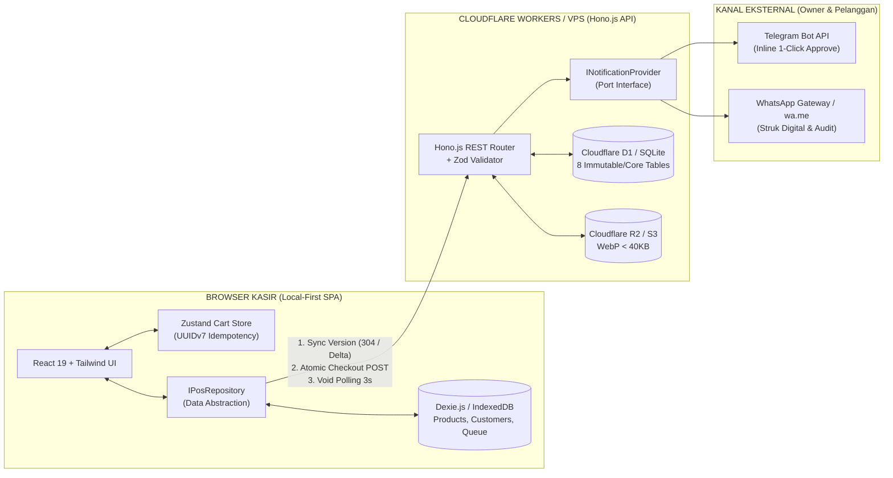

# ARCHITECTURE.md — Topologi Local-First SPA, Edge Serverless, & Port/Adapter

## 1. Diagram Alir Arsitektur Sistem



---

## 2. Strategi Portabilitas & Anti-Vendor Lock-In

| Layer | Implementasi Forever-Free | Jalur Migrasi VPS (Zero Business Logic Change) |
| :--- | :--- | :--- |
| **Frontend Hosting** | Cloudflare Pages (SPA Build) | Sajikan folder statis `dist/` via Nginx atau Caddy. |
| **Client Storage** | `Dexie.js` (IndexedDB) + `Zustand` | $100\%$ berjalan di browser klien, tidak ada perubahan kode. |
| **Backend Compute** | Hono.js di Cloudflare Workers | Gunakan `@hono/node-server` atau adapter Bun di VPS tanpa mengubah rute API. |
| **Database** | Cloudflare D1 (SQLite Edge) | Pindahkan skema SQLite ke `better-sqlite3` / `libSQL` di VPS. |
| **Object Storage** | Cloudflare R2 | Gunakan endpoint S3-Compatible (MinIO / AWS S3). |
| **Notifikasi** | Telegram Bot API + `wa.me` | Ganti implementasi `INotificationProvider` ke container GOWA (WhatsApp Self-Hosted) atau Fonnte. |

---

## 3. Kontrak Abstraksi Wajib (Ports & Adapters)

### 3.1. Frontend Repository Port (`frontend/src/services/posRepository.ts`)
Komponen React **dilarang keras** memanggil `fetch()` atau mengakses tabel `Dexie` secara langsung. Seluruh operasi wajib melewati antarmuka berikut:

```typescript
export interface IPosRepository {
  // Katalog & Sinkronisasi Lokal (<10ms read)
  syncCatalogIfNeeded(): Promise<{ updated: boolean; version: number }>;
  searchProductsLocal(query: string, category: ProductCategory | 'ALL'): Promise<Product[]>;
  
  // CRM Lokal & Normalisasi
  searchCustomersByPhonePrefix(partialPhone: string): Promise<Customer[]>;
  
  // Transaksi & Offline Resilience
  submitTransaction(payload: CreateTransactionInput): Promise<TransactionReceiptResponse>;
  
  // Alur Pembatalan (Void)
  requestVoid(payload: CreateVoidRequestInput): Promise<{ voidRequestId: string; expiresAt: number }>;
  verifyVoidOtp(voidRequestId: string, otpCode: string): Promise<{ status: 'VOIDED' }>;
  pollVoidStatus(voidRequestId: string): Promise<{ status: VoidRequestStatus }>;
}
```

### 3.2. Backend Notification Port (`backend/src/providers/notification.ts`)
Rute API Hono.js dilarang memanggil URL API Telegram atau WhatsApp secara langsung. Gunakan injeksi `INotificationProvider` yang dieksekusi di latar belakang menggunakan `executionCtx.waitUntil()` agar tidak memperlambat respons kasir:

```typescript
export interface VoidApprovalNotificationPayload {
  invoiceNumber: string;
  cashierName: string;
  paymentMethod: 'QRIS' | 'CASH' | 'TRANSFER';
  totalAmount: number;
  itemsSummary: Array<{ name: string; qty: number; subtotal: number }>;
  reason: string;
  plainOtpCode: string;       // Hanya dikirim ke Owner, tidak pernah ke response API kasir
  oneClickApproveUrl: string; // https://pos.koncoku.com/void-approve?token=...
}

export interface INotificationProvider {
  sendVoidApprovalRequest(payload: VoidApprovalNotificationPayload): Promise<void>;
  sendOwnerAuditReceipt(receipt: PublicReceiptData & { totalCostAmount: number; grossProfit: number }): Promise<void>;
}
```

---

## 4. Matriks Peran & Keamanan (RBAC)
- **Autentikasi Kasir Cepat:** Menggunakan 6-digit PIN yang disimpan sebagai *hash* (`SHA-256` dengan *salt* atau `PBKDF2` di Web Crypto API Workers) pada kolom `users.pin_hash`.
- **Pemisahan Hak Akses:**
  - `CASHIER`: Membaca katalog, membuat transaksi, mengajukan permohonan *void*, memasukkan kode OTP *void* dari *Owner*. **Dilarang** melihat `cost_price` (HPP) atau menyetujui *void* sendiri.
  - `OWNER`: Memiliki seluruh akses `CASHIER`, ditambah akses manajemen katalog/stok, laporan laba kotor (selisih `total_amount - total_cost_amount`), dan menyetujui *void* via OTP maupun tautan *One-Click Approve*.