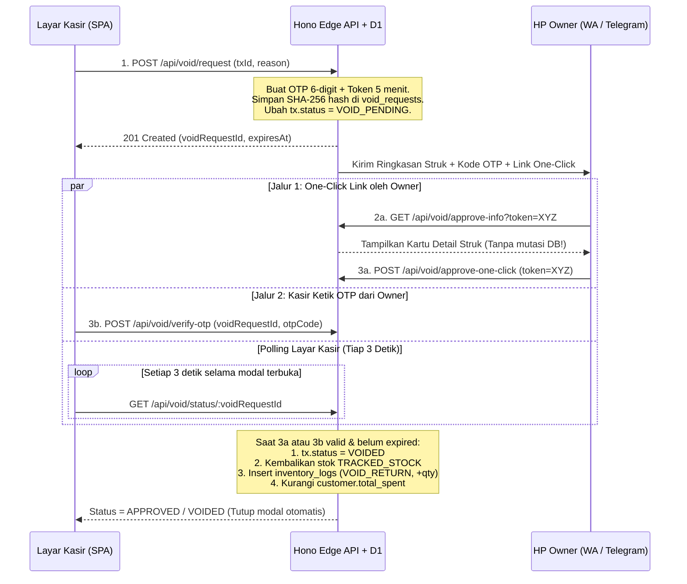

# 03 — Siklus Pembatalan (Void Flow) & Struk Digital WA / CRM

## 1. Pemisahan Tegas 2 Tahap Pembatalan Order

### Kondisi A: Sebelum Jadi Struk (`CART_DRAFT`)
- Status pesanan masih berada di memori lokal `Zustand` dan belum memiliki `invoice_number`.
- Kasir menekan tombol **"Batal / Kosongkan Keranjang"** $\rightarrow$ muncul *Modal Konfirmasi* ringan $\rightarrow$ jika disetujui, keranjang di-reset dan `idempotency_key` di-regenerasi secara lokal **tanpa memanggil API server**.

### Kondisi B: Sesudah Jadi Struk (`ISSUED_RECEIPT`)
Transaksi yang sudah berstatus `COMPLETED` di database **tidak bisa dibatalkan langsung oleh kasir** tanpa otorisasi *Owner*.

---

## 2. Aturan Keamanan Void & Anti-Prefetch Bug
1. **Kerahasiaan OTP & Token:**
   - Server men-*generate* `otp_code` (6 digit angka acak, misal `482910`) dan `approval_token` (32-byte *random hex/base64url*).
   - Database `void_requests` **hanya menyimpan hasil hash SHA-256** (`otp_hash` dan `token_hash`) dengan waktu kedaluwarsa `expires_at = created_at + 300_000` ($5\text{ menit}$).
   - **DILARANG KERAS** mengembalikan `otp_code` atau `approval_token` mentah di dalam *response body* `POST /api/void/request` ke browser kasir. Keduanya hanya boleh dikirim melalui `INotificationProvider` ke kanal pribadi *Owner*.
2. **Mitigasi Bot Link Preview (Anti-Prefetch Bug):**
   - Saat *Owner* menerima tautan `https://pos.koncoku.com/void-approve?token=...` di WhatsApp atau Telegram, bot *crawler* aplikasi chat sering memanggil URL tersebut secara otomatis dengan metode `GET`.
   - Oleh karena itu, rute `GET` (dan endpoint `GET /api/void/approve-info?token=...`) **DILARANG** mengubah status database. Eksekusi pembatalan hanya boleh terjadi ketika *Owner* benar-benar menekan tombol **"SETUJUI PEMBATALAN SEKARANG"** yang menembakkan `POST /api/void/approve-one-click`.
3. **Jurnal Balik Inventori & CRM Saat Void Disetujui:**
   - Ubah `transactions.status = 'VOIDED'`, isi `voided_at`, `void_reason`, dan `void_approved_by` (`'OTP_ENTRY'` atau `'ONE_CLICK_LINK'`).
   - Untuk setiap item transaksi yang produknya bertipe `TRACKED_STOCK`, tambahkan kembali `products.stock_qty = stock_qty + item.qty` dan sisipkan baris baru di `inventory_logs` dengan `change_type = 'VOID_RETURN'` serta `qty_delta = +item.qty`.
   - Jika transaksi terhubung ke `customer_id`, kurangi `customers.total_spent` sebesar `total_amount` transaksi yang dibatalkan.
   - Naikkan `catalog_version` di `system_meta` agar stok di layar kasir langsung diperbarui.

---

## 3. Struk Digital WA-Only & Akuisisi CRM Pelanggan
1. **Normalisasi Nomor WhatsApp:**
   - Fungsi utilitas wajib membersihkan spasi/tanda hubung dan mengubah awalan `08...` menjadi `628...` serta `+628...` menjadi `628...` sebelum disimpan atau dicari.
2. **Auto-Complete Pelanggan Lokal:**
   - Saat kasir mengetik minimal $4\text{ digit}$ nomor telepon di layar *checkout*, sistem mencari di tabel `customers` pada `Dexie.js` dan otomatis mengisi nama pelanggan jika ditemukan.
3. **Format Deep-Link WhatsApp & Struk Web (`/r/:invoice_number`):**
   - Setelah transaksi berhasil, layar kasir menampilkan modal sukses berisi **QR Code** menuju `https://pos.koncoku.com/r/:invoice_number` dan tombol **"Kirim ke WA Pelanggan (Enter)"**.
   - Pesan WhatsApp menggunakan template ringkas yang ramah beserta tautan struk digital:
     > *"Halo Kak {customer_name}, terima kasih sudah mampir ke *Koncoku Cafe & Roastery*! Berikut rincian pesanan Kakak ({invoice_number}) senilai *Rp {total_formatted}*: https://pos.koncoku.com/r/{invoice_number}"*